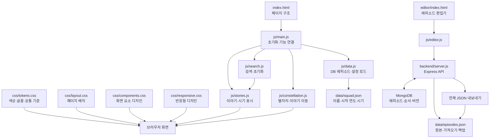

# 봉현마을방범대

## 프로젝트 구성



| 경로 | 역할 |
|---|---|
| `index.html` | 페이지 구조 및 진입점 |
| `login.html` | 별도 계정 로그인 화면 |
| `data/squad.json` | 방범대 이름, 시작 연도, 시기 목록 |
| `data/episodes.json` | 보존하는 기존 원본 데이터 및 DB 최초 가져오기·백업 형식 |
| `css/tokens.css` | 색상, 글꼴 등 공통 디자인 기준 |
| `css/layout.css` | 페이지와 콘텐츠 배치 |
| `css/components.css` | 별자리, 검색창, 이야기 카드 등 요소별 디자인 |
| `css/responsive.css` | 모바일·화면 크기별 레이아웃 |
| `js/main.js` | 페이지 초기화 및 기능 연결 |
| `js/site-auth.js`, `js/login.js` | 메인 화면 인증 확인과 로그인·로그아웃 |
| `js/data.js` | DB 에피소드와 `squad.json` 설정 로드 및 형식 확인 |
| `js/api-client.js`, `js/api-config.js` | API 주소, 인증 토큰, 공통 요청·오류 처리 |
| `js/stories.js` | 이야기와 시기 목록 표시 |
| `js/search.js` | 검색 입력 및 초기화 |
| `js/constellation.js` | 별자리 표시 및 이야기 이동 |
| `editor/index.html` | 에피소드 편집기 화면 (`/editor`) |
| `editor/admin.html` | 관리자 전용 변경 승인·계정 관리 화면 (`/editor/admin.html`) |
| `js/editor.js`, `css/editor.css` | DB 기반 편집기 기능과 화면 스타일 |
| `js/editor-admin.js` | 관리자 승인 요청 및 일반 사용자 계정 관리 |
| `backend/server.js` | Express API 및 MongoDB 연결 |
| `backend/scripts/import-episodes.js` | 기존 `data/episodes.json` 최초 가져오기 |
| `README.md` | 편집·미리보기 안내 |

화면 디자인은 `css/`에서 수정할 것. 메인 화면은 로그인 후 DB의 에피소드 목록을 표시하며, 인증되지 않은 사용자는 `login.html`로 이동한다. `data/episodes.json`은 원본 보존 및 DB 초기 가져오기·백업용으로 남겨 두며 사이트 화면은 이 파일에서 에피소드를 읽지 않는다. 에피소드 편집기는 DB에서 에피소드 목록을 읽고 한 편씩 저장하며 전체 JSON 내보내기를 제공한다. API 주소는 `js/api-config.js` 한 곳에서 설정한다. API 실행과 최초 데이터 가져오기는 아래 안내를 따를 것. API 데이터 계약과 검증 규칙은 [`docs/editor-spec.md`](docs/editor-spec.md)를 참고한다. 방범대 이름·시기 설정은 현재 `data/squad.json`에서 관리한다.

새 팀원을 위한 설계 문서: [시스템 구성도](docs/구성도.md) · [기본설계서](docs/기본설계서.md) · [상세설계서](docs/상세설계서.md). API 계약과 에피소드 검증 규칙은 [편집기 전환 사양](docs/editor-spec.md)을 참고한다.

## 에피소드 추가 및 편집

편집기는 DB에서 에피소드 목록을 읽는다. 관리자가 한 편을 수정하거나 **+ 추가**로 새 에피소드를 작성한 뒤 저장하면 즉시 반영된다. 일반 사용자의 추가·수정·삭제·순서 변경은 승인 요청으로 등록되고, 관리자가 `/editor/admin.html`의 별도 승인 화면에서 승인해야 실제 데이터에 적용된다. 이 화면은 대기 요청을 15초 간격으로 확인하며, 관리자는 같은 화면에서 일반 사용자 계정을 발급하거나 비활성화할 수 있다. `data/episodes.json`과 DB는 자동 동기화하지 않으며, DB 백업 시 **전체 JSON 내보내기**를 사용한다. 다운로드 파일은 DB의 모든 에피소드를 표시 순서대로 담은 `episodes.json`이다.

각 에피소드의 내보내기 형식은 다음과 같다.

```json
  {
    "era": "2026",
    "title": "제목",
    "who": ["한나", "현주", "병준"],
    "text": "있었던 일"
  }
```

`era`는 시기, `who`는 인물 이름 목록이다. `who`는 비워둘 수 있고, 목록에 없는 새로운 시기도 입력할 수 있다. `bright`를 `true`로 지정하면 제목에 레전드 표시가 붙는다. 에피소드의 DB 식별자와 순서 관리용 `order` 값은 내보내기 JSON에 포함되지 않는다.

```json
  {
    "era": "2026",
    "title": "제목",
    "who": ["한나", "현주", "병준"],
    "text": "있었던 일",
    "bright": true
  }
```

JSON 내보내기 파일을 직접 다룰 때는 키와 문자열에 큰따옴표를 사용하고 배열·객체의 마지막 항목 뒤에는 쉼표를 붙이지 않는다. 이야기 문장에 큰따옴표가 필요하면 `\"`로 표기하거나 작은따옴표를 사용한다.

## 백엔드 실행

1. MongoDB replica set을 준비한다. Atlas를 사용할 경우 Atlas 연결 URI를 사용한다. 승인·삭제·순서 변경 트랜잭션 때문에 standalone MongoDB는 지원하지 않는다.
2. `backend` 폴더에서 `npm install`을 실행하고 `.env.example`을 `.env`로 복사한다. `.env`에 MongoDB URI와 데이터베이스명을 설정하고 `SESSION_SECRET`은 32자 이상의 임의 비밀값으로, `ADMIN_USERNAME`과 `ADMIN_PASSWORD`는 초기 관리자 계정으로 지정한다. 관리자 비밀번호는 12자 이상이어야 한다. 비밀값은 `node -e "console.log(require('node:crypto').randomBytes(32).toString('hex'))"`로 만들 수 있으며 저장소에 올리지 않는다. 초기 관리자 계정은 DB에 같은 아이디가 없을 때 한 번만 생성된다.
3. 저장소 루트에서 `npm run import:episodes`를 최초 1회 실행해 기존 `data/episodes.json`을 DB로 가져온다. DB가 비어 있지 않으면 스크립트는 기존 데이터를 덮어쓰지 않고 중단한다.
4. 저장소 루트에서 `npm start`로 API를 실행한다. 기본 주소는 `http://localhost:3000`이다. API 테스트는 저장소 루트에서 `npm test`로 실행한다. 의존성은 백엔드에서 `npm install`로 설치한다.
5. 프런트엔드는 Live Server로 실행한다. 기본 `js/api-config.js`는 로컬 API `http://localhost:3000`을 가리킨다. 공개 배포에서는 이 값을 배포된 API origin으로 바꾸고, 백엔드 `.env`의 `FRONTEND_ORIGINS`에 정확한 프런트엔드 origin을 추가한다. 실제 공개 배포에서는 HTTPS를 사용한다.
6. `/editor`에서 초기 관리자 계정으로 로그인한다. 관리자 화면(`/editor/admin.html`)에서 일반 사용자 계정을 만들고 임시 비밀번호를 전달한다. 계정은 관리자/일반 사용자 두 역할이며, 일반 사용자 요청은 관리자가 승인해야 반영된다. API의 상세 계약은 [`docs/editor-spec.md`](docs/editor-spec.md)를 참고한다.

## 미리보기 및 게시

- 로컬 사이트 확인은 VS Code Live Server 등 웹 서버로 `index.html`을 실행할 것. `file://`에서는 JSON·모듈을 정상적으로 불러올 수 없다.
- GitHub Pages는 프런트엔드 정적 파일만 제공하므로, API와 MongoDB는 별도 HTTPS 호스팅이 필요하다. 게시 시 `js/api-config.js`의 API 주소, 백엔드 `FRONTEND_ORIGINS`, `SESSION_SECRET` 및 초기 관리자 환경 변수를 배포 환경에 맞게 설정할 것.
- GitHub Pages 게시 주소: `https://hyeonju9956.github.io/BongMaBang/`
