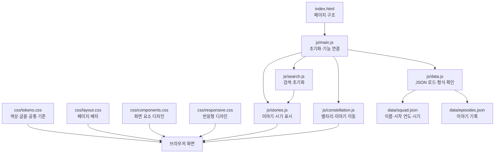

# 봉현마을방범대

## 프로젝트 구성



| 경로 | 역할 |
|---|---|
| `index.html` | 페이지 구조 및 진입점 |
| `data/squad.json` | 방범대 이름, 시작 연도, 시기 목록 |
| `data/episodes.json` | 이야기 기록. 주요 편집 파일 |
| `css/tokens.css` | 색상, 글꼴 등 공통 디자인 기준 |
| `css/layout.css` | 페이지와 콘텐츠 배치 |
| `css/components.css` | 별자리, 검색창, 이야기 카드 등 요소별 디자인 |
| `css/responsive.css` | 모바일·화면 크기별 레이아웃 |
| `js/main.js` | 페이지 초기화 및 기능 연결 |
| `js/data.js` | JSON 로드 및 데이터 형식 확인 |
| `js/stories.js` | 이야기와 시기 목록 표시 |
| `js/search.js` | 검색 입력 및 초기화 |
| `js/constellation.js` | 별자리 표시 및 이야기 이동 |
| `README.md` | 편집·미리보기 안내 |

화면 디자인은 `css/`에서 수정할 것. 기능은 해당 역할의 `js/` 파일에서 수정할 것. 이야기 추가·수정은 `data/episodes.json`에서 진행할 것. 방범대 이름·시기 설정은 `data/squad.json`에서 수정할 것. 별도 빌드 없이 GitHub Pages에서 직접 제공 가능.

## 이야기 추가

`data/episodes.json` 배열의 마지막 이야기 뒤에 쉼표를 붙인 후 새 항목을 추가할 것.

```json
  {
    "era": "2026",
    "title": "제목",
    "who": ["한나", "현주", "병준"],
    "text": "있었던 일"
  }
```

`era`는 `squad.json`의 `eras`와 동일하게 입력할 것. 목록에 없는 시기는 자동으로 마지막에 추가. `who`에는 사람 이름을 배열로 입력. `bright`를 `true`로 지정하면 제목에 레전드 표시.

```json
  {
    "era": "2026",
    "title": "제목",
    "who": ["한나", "현주", "병준"],
    "text": "있었던 일",
    "bright": true
  }
```

JSON 키와 문자열에는 큰따옴표 사용. 배열·객체의 마지막 항목 뒤에는 쉼표 사용 불가. 이야기 문장에 큰따옴표가 필요한 경우 `\"`로 표기하거나 작은따옴표 사용. JSON 문법이나 데이터 형식 오류 발생 시 화면 상단에 오류 안내 표시.

## 미리보기 및 게시

- 로컬 확인 시 VS Code에서 프로젝트를 열고 Live Server 등 로컬 웹 서버로 `index.html` 실행. `file://` 방식으로 직접 여는 경우 JSON 로드 불가.
- GitHub Pages 게시 시 저장소 **Settings → Pages**에서 게시 소스 설정. 프로젝트 사이트 주소 형식: `https://hyeonju9956.github.io/BongMaBang/`
