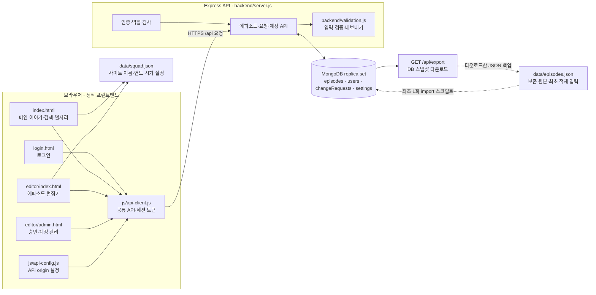

# 시스템 구성도

## 시스템 개요

봉현마을방범대 사이트는 정적 프런트엔드와 Express API, MongoDB로 구성된다. 메인 사이트와 편집기는 에피소드 데이터를 API에서 읽는다. `data/episodes.json`은 기존 원본을 보존하며 최초 DB 적재 및 별도 백업 파일로 사용한다. 운영 중 DB와 이 JSON 파일은 자동 동기화되지 않는다.

## 데이터 흐름

1. 사용자가 로그인하면 브라우저는 API에서 계정과 역할을 확인하고 세션 토큰을 `sessionStorage`에 보관한다.
2. 메인 페이지는 인증 확인 후 `GET /api/episodes`로 에피소드를 가져온다. 이름·시작 연도·기본 시기 목록은 `data/squad.json`에서 읽으며, DB 에피소드에 새로운 시기가 있으면 화면 목록에 추가한다.
3. 편집기의 읽기·쓰기와 승인 관리의 요청 처리는 동일 API를 사용한다. 관리자의 변경은 즉시 반영되고, 일반 사용자의 변경은 `changeRequests`에 대기 상태로 저장된 뒤 관리자 승인 시 반영된다.
4. `npm run import:episodes`는 DB가 비어 있을 때 기존 `data/episodes.json`을 최초 적재한다. 운영 중 JSON 원본을 편집해도 DB에는 반영되지 않는다.
5. JSON 백업은 편집기의 전체 내보내기에서 생성한다. 서버가 DB 에피소드를 순서대로 직렬화해 내려주며 파일을 자동으로 저장소에 쓰지는 않는다.

## 배포 경계

- 프런트엔드: 정적 웹 호스팅 또는 로컬 웹 서버. HTML, CSS, 브라우저 JavaScript, `data/squad.json`을 제공한다.
- 백엔드: Node.js 20 이상, Express API. MongoDB 연결 문자열과 비밀 설정은 환경 변수로 제공한다.
- 데이터베이스: MongoDB replica set. 승인 적용·삭제·순서 변경에서 transaction을 사용하므로 standalone 구성은 지원하지 않는다.
- 프런트엔드의 API origin은 `js/api-config.js` 한 곳에서 지정한다. 브라우저 배포 origin은 백엔드 `FRONTEND_ORIGINS`에도 허용해야 한다.
- GitHub Pages는 API나 MongoDB를 호스팅하지 않는다. 공개 서비스에는 별도 HTTPS API와 DB가 필요하다.

## 관련 문서

- [기본설계서](기본설계서.md): 사용자, 기능, 권한과 운영 원칙
- [상세설계서](상세설계서.md): 파일, API, 컬렉션, 데이터 계약
- [에피소드 편집기 전환 사양](editor-spec.md): 데이터 검증과 API 세부 계약
